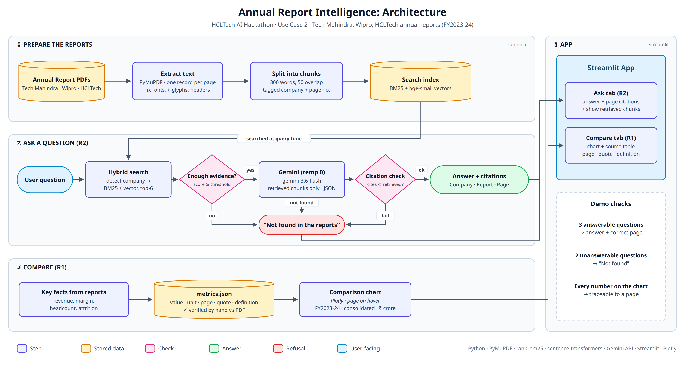

# Annual Report Intelligence

HCLTech AI Hackathon, IIT Gandhinagar. Use Case 2: IT Companies in India.

This project compares the FY2023-24 annual reports of **Tech Mahindra, Wipro and HCLTech** and answers questions **only from those reports**. Every answer includes a page citation. When the reports don't contain the answer, the app replies "Not found in the reports."



## Quick start

```bash
git clone <repo-url> && cd annual-report-intelligence
python -m venv .venv && source .venv/bin/activate      # Windows: .venv\Scripts\activate
pip install -r requirements.txt
cp .env.example .env                                     # then paste your GEMINI_API_KEY

# 1. Put the PDFs in data/pdfs/ with these exact names:
#    techmahindra_fy24.pdf   wipro_fy24.pdf   hcltech_fy24.pdf

python -m src.ingest          # PDFs -> data/chunks.jsonl
python -m src.index           # BM25 + embeddings -> data/index/
python -m src.retrieve "What was Wipro attrition?"       # test retrieval
python -m src.answer   "What was Wipro attrition?"       # test full answer
python eval.py                # 6 answerable + 4 unanswerable checks
streamlit run app.py          # the app
```

PDFs and indexes are gitignored because they're too large for the repo. Each member downloads the PDFs (see the source register) and runs `ingest` and `index` locally.

## Repository layout

```
├── app.py                    # Streamlit: Compare tab (R1) + Ask tab (R2)
├── eval.py                   # answerable / unanswerable test set
├── src/
│   ├── config.py             # companies, file names, thresholds, model names
│   ├── ingest.py             # PDF -> page text -> tagged chunks
│   ├── index.py              # BM25 + bge-small embeddings
│   ├── retrieve.py           # hybrid search (RRF) + company filter
│   └── answer.py             # relevance gate -> Gemini (JSON) -> citation check
├── scripts/
│   └── propose_metrics.py    # Gemini proposes chart values -> human verifies
├── data/
│   ├── pdfs/                 # annual reports (not committed)
│   ├── index/                # generated indexes (not committed)
│   └── metrics.json          # hand-verified chart values (committed)
├── docs/architecture.png
├── REPORT.md                 # 300-word submission write-up
└── FAILED.md                 # log of failed attempts
```

## How it works

1. **Ingest:** PyMuPDF extracts text page by page. Each page is split into chunks of about 400 words, and every chunk is tagged with `company`, `fy` and `page`.
2. **Index:** BM25 for exact terms, plus `bge-small-en-v1.5` embeddings for meaning.
3. **Retrieve:** the app detects which company the question names, ranks chunks with both methods, and merges the rankings with reciprocal-rank fusion. If no company is named, it takes the top chunks from each company.
4. **Answer:** refusals happen at three points:
   1. If the best similarity is below `MIN_SCORE`, the app refuses without calling the LLM.
   2. Gemini (temperature 0) answers only from the retrieved chunks and returns `found=false` if they don't contain the answer.
   3. Cited chunk IDs must be among the retrieved chunks; if none are, the app refuses.
5. **Compare:** chart values come from `data/metrics.json`. Gemini proposes each value with its page and quote, and a person verifies it against the PDF.

**Page numbers** are 1-based PDF page indices (what a PDF viewer shows), not the page numbers printed in the report.

## Source register

| Company | Report title | Fiscal year | URL | Downloaded on |
|---|---|---|---|---|
| Tech Mahindra | Integrated Annual Report 2023-24 | FY2023-24 | _fill_ | _fill_ |
| Wipro | Integrated Annual Report 2023-24 | FY2023-24 | _fill_ | _fill_ |
| HCLTech | Annual Report 2023-24 | FY2023-24 | _fill_ | _fill_ |

## Team and contributions

| Member | Owns | Contributions (3 sentences each) |
|---|---|---|
| A | `config.py`, `ingest.py`, `index.py`, PDFs | _fill at 3:45 pm_ |
| B | `retrieve.py`, `answer.py`, `eval.py`, refusal tuning | _fill_ |
| C | `metrics.json`, `propose_metrics.py`, `app.py`, docs | _fill_ |

## Failed attempts

See [FAILED.md](FAILED.md).
